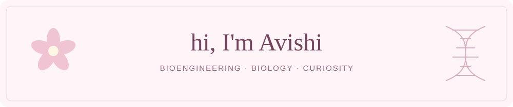

  

I'm a **bioengineer studying computational and structural biology**. I like exploring biological questions through code and data.

🌷 I enjoy biology-related hackathons and competitions on **Kaggle**. I'm still learning, one dataset at a time.

🧠 Currently building **neuroscience-related projects**.

🧬 Interested in how computational methods can help us understand biological systems, from molecular structures to the brain.

### A little of what I'm working on

[**Semester 1 projects →**](https://github.com/Avishi1503/Projects_Sem1)  
Coursework, Python experiments, and bioinformatics algorithm comparisons.

🌸 &nbsp; learning as I go &nbsp; 🌸

